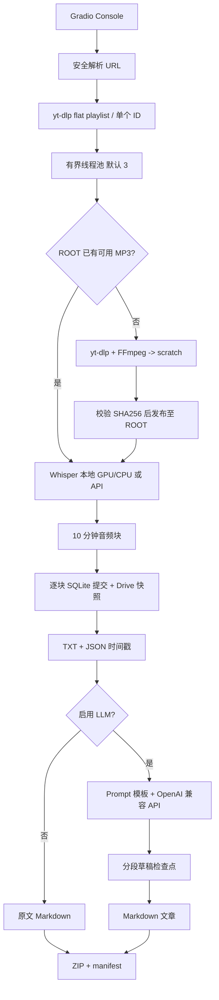

# 系统架构与数据契约

## 两层存储

- ROOT（本地 data 或 Colab Drive）：持久化 `media/`、`metadata/`、`models/`、`transcripts/`、`articles/`、`db/studio_catalog.db`。
- SCRATCH（本地 work 或 Colab /content）：yt-dlp 临时文件、分段 WAV、SQLite 工作副本和 ZIP 导出。
- 绝不启动时复制整个 ROOT；仅恢复 Studio SQLite 快照。已有媒体在 ROOT 中直接复用；新下载先本地完成、哈希校验后写入 ROOT。
- 完整分块后以事务提交 SQLite 并发布独立快照。若虚拟机退出，已提交分块不会重复转写。
- 单个 ROOT **只能有一个 Studio 主进程写入**。同一主进程内部用 RLock 串行 SQLite 写事务，任务池最多 N 个不同视频。

## 主要数据表

| 表 | 主键 | 用途 |
|---|---|---|
| videos | `video_id` | YouTube ID + 白名单 metadata |
| assets | `video_id` | 音频路径、SHA256、文件大小、时长 |
| transcripts | `(video_id, run_key)` | ASR 模型、音频 SHA、配置哈希、状态和输出文件 |
| chunks | `(video_id, run_key, chunk_index)` | 分块转写片段和绝对时间戳 |
| articles | `(video_id, run_key, prompt_hash, llm_model)` | Prompt 版本对应文章及全文 |
| jobs | `(video_id, stage)` | 下载、转写、文章任务状态/错误/重试次数 |

### 为什么使用独立数据库？

现有 `zhuweiyi_corpus/db/catalog.db` 是旧版工程产生的数据库，架构不同。新程序只读写 `studio_catalog.db`，不会覆盖旧文件；会自动扫描并复用 `media/<id>.mp3` 和 `metadata/<id>.json`。

## 重要限制

- Drive 挂载不是事务文件系统，`os.replace` 和验证性复制只能缩小损坏窗口，不是跨 Colab 分布式锁；提供 `.prev.db` 降低快照损坏风险。
- 本地 Whisper 使用单个模型锁，默认三个工作线程可并行下载、切块及 API 请求，但本地 GPU 推理并非三路同时执行（以防显存爆炸）。
- 当前不支持多台 Colab 同时写入同一 ROOT；如需横向扩容应改用 PostgreSQL + 任务队列 + 对象存储。
- 完全离线的频道扫描无法精确得知频道的所有视频；`仅处理已有`模式仅取 ROOT 中已知、可匹配频道的音频。
- 分块 JSON 的时间戳是相对视频的绝对毫秒；如果 API 只返回一个文字段落，时间戳仅到音频块级别。
- 字幕和自动文章不是独立事实核验。不同 LLM 端点可能有上下文长度和速率限制，按分段减少一次性输入。

## Code category migration (Phase 1)

- `studio/domain/links.py`: canonical URL parser; `studio/links.py` remains a compatibility shim.
- `studio/domain/models.py`: `VideoResult` contract, re-exported from `studio.engine` for existing clients.
- `studio/application/offline_selection.py`: strict offline cache selection; cached playlists and unverified custom channel URLs fail closed instead of pulling unrelated videos.
- The external API wrappers, storage adapter and UI will be relocated in later PRs after contract tests are complete.
